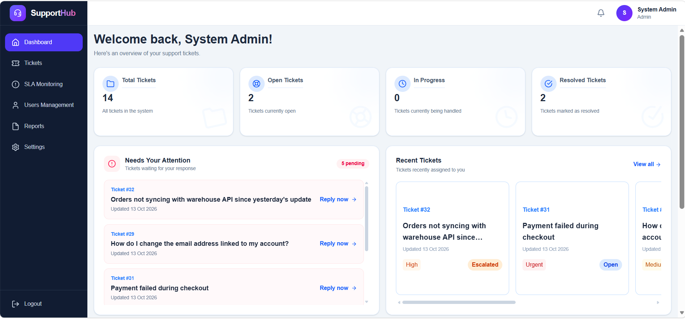
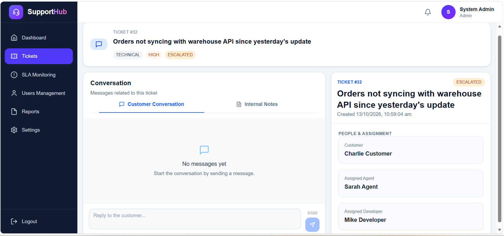
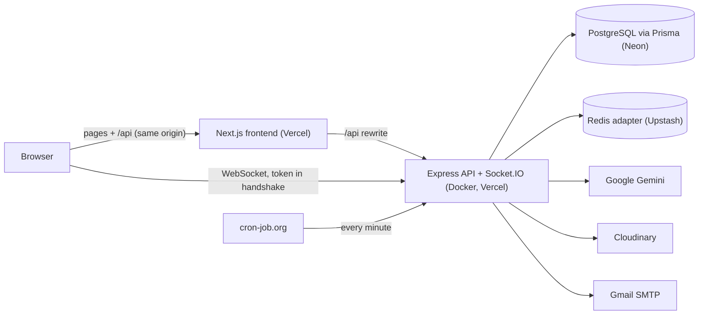

# SupportHub — AI-Powered Customer Support & Ticket Management

SupportHub is a full-stack help-desk platform. Customers raise and track tickets, support agents resolve them or escalate to developers, and admins monitor SLA compliance and team performance. Gemini-powered assistance (categorization, priority suggestions, reply drafts and conversation summaries) is built into the workflow, and ticket updates and chat run in real time.

**Live demo:** https://tridhya-inernship-mern-ylwh.vercel.app
**Demo access:** test credentials are available on request.

<!-- TODO: add screenshots to a docs/screenshots folder and update the paths below -->




---

## Features

### By role

- **Customer** - Create tickets with attachments, get optional AI category/priority suggestions, chat with the assigned agent, close
  a resolved ticket or repoen it
- **Support Agent** - Work assigned tickets, chat with customers, generate AI reply drafts, see AI escalation recommendations, escalate to
  a developer, use the internal team chat
- **Developer** - Receive escalated tickets, generate an AI conversation summary, move tickets to In Development, resolve them
- **Admin** - Assign and reassign agents, manage users and roles, monitor SLA breaches, view reports and team performance

### Ticket workflow

`OPEN → IN_PROGRESS → ESCALATED → IN_DEVELOPMENT → RESOLVED → CLOSED`
The customer confirms the resolution: closing the ticket ends it, and reopening it sends it back to the stage that was handling it. Every change is recorded in an activity log.

### AI assistance (Google Gemini)

- **Category and priority suggestion** at ticket creation, with a reason and a confidence score
- **Reply drafts and an escalation recommendation** for agents
- **Conversation summaries** for developers (what the issue is, what was observed, what was already tried)
- **Opt-in by design.** AI runs only when the user asks for it, which controls cost and leaves the final decision with the user. A suggestion is saved only when it is accepted.
- **Graceful failure.** If the AI service is unavailable, the workflow still works manually and users see a friendly message, with details kept in server logs.

### Real time

- Live chat per ticket, plus a separate internal chat for staff that customers never see
- Live ticket status updates across dashboards, with toast notifications and a notification bell
- Socket authentication uses the JWT at the handshake, rooms are authorized per ticket, and a socket is disconnected when its token expires

### SLA monitoring

- An SLA record is created with each ticket, with first-response and resolution deadlines based on priority
- A scheduled job runs every minute, sends a warning email as a deadline approaches, and records a breach with an email when it passes
- An SLA Monitoring page for staff and a reports page for admins (volume, status and priority distribution, breaches, resolution time, team performance)

### Other

- Attachments stored on Cloudinary, validated by file content and not just extension, with cleanup if ticket creation fails
- Internal notes: private, staff-only notes saved on each ticket and never visible to customers
- Email notifications that never block or roll back a ticket update when they fail
- Role-based access control enforced on the server, with ownership checks per ticket

---

## Architecture



### Tech stack

| Layer             | Technology                                                    |
| ----------------- | ------------------------------------------------------------- |
| Frontend          | Next.js (App Router), TypeScript, Tailwind CSS, Redux Toolkit |
| Backend           | Node.js, Express, TypeScript                                  |
| Database          | PostgreSQL with Prisma (Neon)                                 |
| Real time         | Socket.IO with the Redis adapter (Upstash)                    |
| AI                | Google Gemini                                                 |
| Storage and email | Cloudinary, Nodemailer with Gmail SMTP                        |
| Auth              | JWT in httpOnly cookies, role-based access control            |
| Deployment        | Docker, Vercel, cron-job.org for the SLA scheduler            |

### Design decisions

- **Separate frontend and backend.** Socket.IO needs a long-lived server process, which a purely serverless setup doesn't give you.
- **PostgreSQL.** Tickets, assignments, activity logs and SLA records are relational and depend on each other.
- **Same-origin API proxy.** Next.js rewrites forward `/api` to the backend, so the auth cookie belongs to the frontend's domain and works with route protection in middleware.
- **Token in the WebSocket handshake.** Sockets connect directly to the backend domain, so they authenticate with an explicit token and not a cookie.
- **WebSocket-only transport and a Redis adapter.** This avoids polling-session problems on multi-instance hosting, and it makes broadcasts reach every instance.
- **External scheduler for SLA checks.** A scheduled HTTP call is more reliable on a platform that doesn't guarantee a single always-on process.

---

## Project structure

```
day-56/
├── backend/     Express API, Prisma schema, Socket.IO, scheduled SLA job, Dockerfile
└── frontend/    Next.js app (dashboard, tickets, chat, reports)
```

---

## Getting started

### Prerequisites

Node.js 22 or later, a PostgreSQL database (Neon works), a Redis instance (Upstash works), and API credentials for Gemini and Cloudinary.

### Backend

```bash
cd backend
npm install
cp .env.example .env
npx prisma generate
npx prisma migrate deploy
npm run dev
```

Main environment variables:

```
DATABASE_URL=
JWT_SECRET=
FRONTEND_URL=http://localhost:3000
REDIS_URL=
GEMINI_API_KEY=
CLOUDINARY_CLOUD_NAME=
CLOUDINARY_API_KEY=
CLOUDINARY_API_SECRET=
# Gmail SMTP credentials: see .env.example
```

### Seed data in backend:

npx prisma seed

### Frontend

```bash
cd frontend
npm install
cp .env.example .env
npm run dev
```

```
BACKEND_URL=http://localhost:5000/api
NEXT_PUBLIC_API_URL=/api
NEXT_PUBLIC_SOCKET_URL=http://localhost:5000
```

The app runs at `http://localhost:3000`.

### Run the backend in Docker

```bash
cd backend
docker compose up -d --build
```

---

## Testing

A manual test plan of 130+ cases covers authentication, role restrictions, the ticket lifecycle, messaging, AI assistance, SLA monitoring, notifications, file uploads, real-time updates and production checks. Defects found in testing were fixed and retested.

---

## Known limitations and next steps

- Customers can set any priority, with no validation against priority inflation
- Authentication uses a single token. A short-lived access token with a refresh token would limit the damage of a stolen token
- Notifications are session-scoped and are not stored in the database
- Internal staff discussion happens in a chat room, and persistent internal notes are not built
- Free-tier hosting means the first request after a quiet period can be slow

---

## Author

**Sarah** — final-year Computer Science student, full-stack developer (React, Node, TypeScript).
Built during a 60-day MERN internship at Tridhya Tech.
